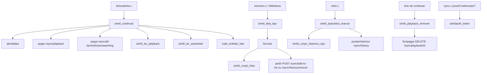
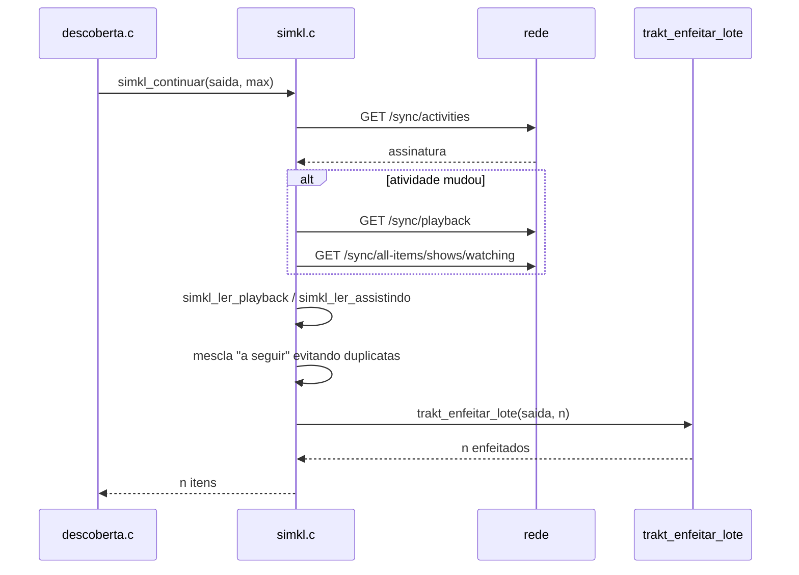

# simkl.c — Integração com Simkl

## Para que serve

Paralelo do `trakt.c` para Simkl: alimenta a fileira "Continuar assistindo" com itens pausados + "a seguir", fornece a watchlist (Plan to Watch) e permite escrever de volta o "+" (adicionar à lista), o "-" (tirar), a marcação de episódios/histórico e remoção de playback. Roda em todas as plataformas (webOS, Android, Tizen .tpk/.wgt); não há `#ifdef` de plataforma.

## Funções públicas

| Assinatura | O que faz | Fio | Pré-condições | Travas | Efeitos colaterais |
|---|---|---|---|---|---|
| `int simkl_ativo(void)` | 1 se há token do Simkl (`simklauth_token()`). | Qualquer | — | nenhuma | — |
| `const char *simkl_aviso_sem_vinculo(int querSimkl)` | Retorna `SIMKL_VINCULE` quando apropriado. | Principal | — | nenhuma | — |
| `int simkl_ler_playback(const char*, CatItem*, long long*, int)` | Lê corpo de `/sync/playback`. | Pura | Testes/leitura. | nenhuma | Preenche `dst` e `ids`. |
| `int simkl_ler_assistindo(const char*, CatItem*, int)` | Lê corpo de `/sync/all-items/shows/watching` e `/anime/watching` (próximo episódio). | Fio de descoberta | — | nenhuma | No fluxo de Continuar assistindo, anime com ID Simkl busca `/anime/{id}` mesmo quando já tem IMDb, para resolver título canônico, pôster, IDs externos e temporada; `E#` usa essa temporada quando disponível. Metadados com numeração global preservam o par temporada/episódio do catálogo Nuvio e a miniatura global quando disponível. |
| `int simkl_ler_plantowatch(...)` | Lê corpo de `plantowatch`. | Pura | — | nenhuma | Preenche `dst` com `naLista=1`. |
| `int simkl_corpo_lista(...)` / `simkl_rota_lista(...)` | Monta corpo/rota do +/- na lista. | Pura | — | nenhuma | Usado por `fioLista`. |
| `int simkl_continuar(CatItem*, int)` | Preenche "Continuar assistindo" do Simkl. | Fio de descoberta (bloqueia) | Token ativo. | `trava` | Preenche `play[]`, `proxIds[]`; chama `trakt_enfeitar_lote`, que preserva o episódio confirmado pelo Simkl mesmo se o catálogo do Nuvio usar numeração global. |
| `int simkl_e_a_seguir(const char *id)` | 1 se id é "a seguir" da última leitura. | Principal | — | `trava` | — |
| `int simkl_plantowatch(CatItem*, int)` | Preenche Plan to Watch. | Fio de descoberta (bloqueia) | Token ativo. | `trava` | Atualiza `ptw[]`. |
| `int simkl_na_plantowatch(const char *imdb)` | 1 se obra está na watchlist conhecida. | Principal | — | `trava` | — |
| `int simkl_lista_tipo(...)` | Adiciona/tira da Plan to Watch num fio. | Principal | — | `trava` | Dispara `fioLista`; estado `listaEstado`. |
| `int simkl_lista_estado(void)` | Estado da última escrita (0/1/2/3). | Principal | — | nenhuma | — |
| `int simkl_playback_remover(const char *imdb)` | DELETE `/sync/playback/<id>` num fio. | Principal | — | `trava` para leitura do id | Dispara `fioApagar`. |
| `int simkl_corpo_historico_eps(...)` / `_titulo(...)` / `simkl_rota_historico(...)` | Montam corpo/rota de marcação de histórico. | Pura | — | nenhuma | — |
| `int simkl_episodios_marcar(...)` | POST histórico em lote (síncrono). | Fio de trabalho | — | `travaCorpo` | Chama `postarHistorico`. |
| `int simkl_titulo_marcar(...)` | POST histórico título inteiro (síncrono). | Fio de trabalho | — | nenhuma | Chama `postarHistorico`. |
| `int simkl_historico_aplicar(const char*)` | Importa os `watched_at` da série aberta, tirados da biblioteca em memória, no mapa compartilhado (anime: mapeado na lista de episódios da tela). | Worker de extras | Simkl vinculado; série aberta. | `trava` | Sem pedido próprio: espera a biblioteca (`bibGarantir`, até 60 s) se ela ainda está chegando. |
| `void simkl_biblioteca_iniciar(void)` | Carrega a biblioteca do perfil em segundo plano (veja **Biblioteca** em IMPACTOS). | Principal (`app.c`, ao abrir o perfil) | Simkl vinculado. | `trava` | Dispara `bibCarregarFio`; grava `simkl-biblioteca-p<N>.txt` (`simklbib.c`); importa as marcas das séries comuns. |
| `char *simkl_lista_corpo(const char *tipo, const char *estado)` | Uma lista por estado no formato de `/sync/all-items/<tipo>/<estado>`, tirada da biblioteca. | Fio de quem lê (bloqueia) | Simkl vinculado. | `trava` | Confere `/sync/activities` se a última conferência passou de `SMK_BIB_FRESCA` (60 s) ou houve escrita deste app; espera até 60 s. Usado por `listas.c`. |
| `int simkl_biblioteca_carregando(void)` | 1 enquanto um carregador da biblioteca roda. | Qualquer | — | `trava` | — |
| `void simkl_esquecer(void)` | Limpa caches (logout/desvincular). | Principal | — | `trava` | Zera `nPlay`, `nProx`, `nPtw`, corpos guardados. |

## Estado global

| Variável | Tipo | Quem escreve | Quem lê |
|---|---|---|---|
| `play[]`, `nPlay` | `static struct[]` | `simkl_continuar`, `fioApagar` | `simkl_playback_remover`, `simkl_e_a_seguir` |
| `proxIds[][]`, `nProx` | `static char[][]` | `simkl_continuar` | `simkl_e_a_seguir` |
| `ptw[][]`, `nPtw` | `static char[][]` | `simkl_plantowatch`, `ptwMarcar` | `simkl_na_plantowatch` |
| `corpoPlay`, `assCw` | `static` | `simkl_continuar` | `simkl_continuar`: `/sync/playback` guardado enquanto as datas de playback das atividades não mudam |
| `bibCorpo`, `bibAtiv`, `bibConferida` | `static` | `bibCarregarFio` (via `bibPublicar`) | `simkl_lista_corpo`, `simkl_continuar`, `simkl_plantowatch`, `simkl_historico_aplicar`, Perfil e estatísticas (`perfilDaBiblioteca`) |
| `listaEstado`, `listaFioVivo`, `alvoId`, `alvoTipo`, `alvoAdicionar` | `static` | `simkl_lista_tipo` / `fioLista` | UI/espelhamento |

## Grafo de chamadas (flowchart)

## Fluxo principal (sequenceDiagram)

## IMPACTOS

- **Se mexer em `simkl_continuar`**: as listas (watching de séries e de anime, entre outras) vêm da biblioteca (`bibAtualizada`); só `/sync/playback` é pedido de novo, quando as datas de playback das atividades mudaram. Meia resposta não é guardada.
- **Biblioteca**: um arquivo por perfil (`simkl-biblioteca-p<N>.txt`, `simklbib.c`) com o JSON de all-items e as `/sync/activities` que ele reflete; preso à assinatura do token, apagado ao desvincular, sair ou num 401. Ao abrir o perfil carrega a cópia salva e confere as atividades, pedidas antes de qualquer download (uma mudança durante o download aparece no próximo delta). Atividades iguais: nada a baixar. Um estado mudou: um delta `/sync/all-items?date_from=<"all" anterior>`, juntado por ID Simkl. `removed_from_list` mudou: `extended=simkl_ids_only`, e o que falta sai. Sem cópia, sem data de partida, delta acima do `max_items` ou um item sem ID Simkl que serve em vários: a biblioteca inteira, `/sync/all-items/{shows,anime,movies}` um depois do outro, sem `page`/`limit` (o all-items não pagina). Um tipo acima do `max_items` do Simkl (400) é pedido estado por estado, e um estado ainda acima com `include_all_episodes=original`, como manda o guia de sync do Simkl (api.simkl.org/guides/sync). Nada é gravado antes de todas as partes chegarem; um pedido que falha mantém a biblioteca e o próximo leitor tenta de novo.
- **Anime em `simkl_ler_assistindo`**: a resposta pode usar `anime` ou `show` como objeto interno; no fluxo de Continuar assistindo, qualquer item com ID Simkl busca os detalhes para recuperar título canônico, pôster, IDs externos e a temporada do item, mesmo se o IMDb já veio na resposta. Se o catálogo Nuvio usa numeração global dentro de uma temporada, o item mantém essa numeração (por exemplo, One Piece E1123 = S22E1123 no catálogo), sem convertê-la para o padrão diferente do Cinemeta; a miniatura exata do episódio vem do catálogo Nuvio se disponível. Sem essa numeração no catálogo, a resolução continua usando a sequência de episódios do provedor.
- **Histórico de episódios**: ao abrir uma série, o worker importa os episódios com `watched_at` da biblioteca em memória para `vistoep`; aceita o objeto interno `anime` ou `show`, pois a resposta pode usar ambos. Se a entrada não tiver IMDb, primeiro tenta o ID Simkl quando o fluxo de Continuar assistindo já o associou aos detalhes oficiais do anime; sem essa associação, só usa a série aberta quando o TMDB ID coincidir exatamente. Não há pedido por série nem por episódio: a biblioteca já traz o histórico. A biblioteca é pedida com `include_all_episodes=yes`, `episode_watched_at=yes` e `episode_tvdb_id=yes`, como a implementação Desktop, para receber o histórico por episódio com coordenadas e IDs TVDB. Mantemos cada `watched_at` informado em vez de marcar automaticamente todos os episódios anteriores ao último: o Simkl pode conter lacunas ou episódios vistos fora de ordem. Episódios ausentes não são marcados como não vistos, para não apagar estado vindo de Trakt ou da conta Nuvio. As coordenadas TVDB podem vir aninhadas em `episode.tvdb.season` / `episode.tvdb.episode` ou nos campos achatados `tvdb_season` / `tvdb_number`. Quando há `episode.ids.tvdb_id`, tentamos primeiro a correspondência exata com o ID TVDB dos episódios já publicados no catálogo; só aceitamos um resultado único e confirmado, e então usamos o par de temporada/episódio do catálogo. Para anime cujo Simkl concentra os episódios globais na temporada 1, números acima do último episódio da temporada 1 são convertidos pela posição na lista final do catálogo ativo, ignorando especiais; isso mantém o estado alinhado ao addon que a tela realmente usa. Sem uma lista final, a ficha de metadados tenta mapear a numeração absoluta. Se um número absoluto alto não puder ser mapeado, ele é ignorado em vez de gravado como um episódio presumido da temporada 1.
- **Se mexer em leitores puros**: `simkl_ler_playback` ignora item sem `ids.imdb` (`simkl.c:97`); para anime só usa numeração TVDB (`simkl.c:127-128`); progresso vem em porcentagem 0-100 (`simkl.c:146`).
- **Se mexer em `simkl_corpo_historico_titulo`**: desmarcar série SEM lista de temporadas retorna 0 para não apagar o histórico inteiro do Simkl (`simkl.c:322-326`).
- **Se mexer em `simkl_lista_tipo`**: "-" só manda se o título está no `ptw[]` conhecido; senão recusa para não apagar biblioteca (`simkl.c:647-652`).
- **Se mexer em `postarHistorico`**: sucesso 2xx com `"not_found"` contendo `"ids"` é tratado como falha (`simkl.c:687-688`).
- **Contratos com Kotlin/.NET/JS**: não há neste módulo.
- **Testes**: `tests/simkl_cw.sh` cobre a importação do histórico e os deltas; `tests/simkl_biblioteca.sh` a montagem da biblioteca, o `max_items` e a janela de conferência; `tests/simklbib.sh` o arquivo salvo; `tests/simkl_anime_cw.sh` cobre a integração e o mapeamento de episódios de anime.

## Regressões já acontecidas

- **#110** — Simkl como fonte de "Continuar assistindo" e destino do "+" (commit `ae51d9b0`).
- **#244/#243** — Um card por obra; remoção de playback; nota real (commit `8e7f4098`, tocou Simkl no enfeite).
- **Marcação em lote** (commits `7714dc8b`, `3990b12e`): `simkl_episodios_marcar` e `simkl_titulo_marcar`.
