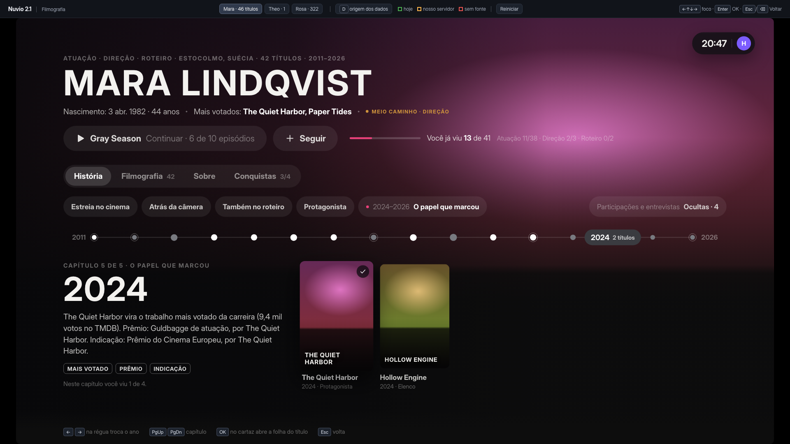

# Filmografia 2.1 — protótipo de UX

Mockup interativo da ficha da pessoa. Não toca em `src/`. Dados falsos, sem rede, sem CDN.

Mesma linguagem visual do app e do mockup Reassistir (`design/2.1/tv.css`): ilha escura fria, foco = superfície um degrau mais clara (sem aro), botão/chip em foco = pílula cheia no acento, cartaz em foco sobe com sombra, conquista no dourado do aviso "Conquista nova".



## Como abrir

```sh
python3 -m http.server 8731     # da raiz do repositório: a fonte Inter vem de design/universo-2026/assets
# http://127.0.0.1:8731/docs/prototypes/filmografia/
node --test docs/prototypes/filmografia/model.test.mjs   # 15 testes do modelo
```

Servido de dentro desta pasta também abre, mas cai na fonte do sistema. Módulos ES não abrem por `file://`.

Quadro fixo de 1920x1080, escalado para a janela. Tudo pelo teclado:

| Tecla | Faz |
|---|---|
| Setas | D-pad |
| Enter | OK |
| Esc / Backspace | Voltar |
| PgUp / PgDn | Capítulo anterior / seguinte (atalho de teclado; na TV é o chip do capítulo) |
| 1–4 | Responde o quiz (atalho; na TV é setas + OK) |
| D | Liga o contorno de origem dos dados; no quiz também mostra a resposta certa |

A barra de cima fica fora da TV: troca de pessoa, liga a origem dos dados e reinicia a demonstração (marcas e "Seguir" ficam em `localStorage`).

`?teclas=baixo,ok,...` repete uma sequência de teclas num estado limpo (aceita `cima baixo esq dir ok voltar pgup pgdn dados`, `abre:<id>`, e `certa`/`errada` no quiz). `?p=theo` abre outra pessoa. Foi assim que as capturas saíram.

Três pessoas para testar os extremos:

- **Mara** — 46 títulos, atua, dirige e escreve. Caso normal.
- **Theo** — 1 crédito, sem biografia em português. Um capítulo, um ano, trilha 0 de 1.
- **Rosa** — 322 títulos, 141 deles participações, entrevistas e pontas. 6 capítulos, 46 anos na régua.

## Arquivos

- `model.mjs` — tudo que é regra, sem DOM: junção de créditos, ruído, marcos, capítulos, contagem, conquistas, quiz e lista de bloqueio, filtros.
- `model.test.mjs` — testes do modelo.
- `app.js`, `app.css`, `index.html` — tela e navegação.

## Fluxo atual

A ficha da pessoa é uma camada por cima da página do título.

| O que | Onde |
|---|---|
| Abre a camada | `src/detail.c:1545` (`detail_mostrar_pessoa`), estado em `src/detail.c:231` |
| Pedido ao TMDB: `/person/{id}` com `append_to_response=combined_credits` | `src/pessoa.c:64` |
| Lê só `biography`, `known_for_department`, `profile_path` | `src/pessoa.c:77-80` |
| Lê só o array `cast` | `src/pessoa.c:85-87` |
| Ordena por popularidade | `src/pessoa.c:112` |
| Teto de 24 créditos | `src/pessoa.h:10` (`PES_MAX`) |
| Teclas: grade de 6 colunas, Esquerda na coluna 0 abre o menu, OK abre o título, Voltar fecha | `src/detail.c:2555-2585`, colunas em `src/detail.c:271` |
| Desenho: foto, nome, área, biografia, grade "Filmografia" | `src/detail.c:7027`, título da grade em `src/detail.c:7061` |
| Biografia cortada em 6 linhas | `src/detail.c:7055` |

## O que dói hoje

1. **Biografia cortada sem saída.** 6 linhas e acabou; não há "ler mais" (`src/detail.c:7055`). Sem texto no idioma do perfil, fica vazio: não cai para o inglês.
2. **Só elenco.** Direção e roteiro nunca aparecem: só o `cast` é lido (`src/pessoa.c:85-87`). Um diretor abre com a ficha vazia ou só com pontas como ator.
3. **24 créditos e pronto** (`src/pessoa.h:10`). Quem tem 300 perde quase tudo, e sem aviso.
4. **Ordem só por popularidade** (`src/pessoa.c:112`). Não há ordem por ano, nem filtro de tipo ou função.
5. **Ruído misturado.** Entrevista, "Self" e ponta de 1 episódio disputam as 24 vagas com os trabalhos de verdade.
6. **Dados que o TMDB já manda e ninguém lê.** Nascimento, morte, lugar e outros nomes vêm no mesmo pedido (`src/pessoa.c:77-80` ignora).
7. **Nada sobre você.** O card mostra ano e personagem; não diz se você já viu, nem quanto falta.
8. **Sem história.** É uma grade; não dá para entender a carreira.

## Fluxo proposto

Quatro abas. O foco abre na régua de anos, na aba História.

- **Topo.** Funções, lugar, nome, nascimento/morte, mais votados, o maior nível ganho. Botão do próximo título ("Continuar · 6 de 10 episódios"), **Seguir** e "Você já viu N de M" com barra e contagem por função. Na Filmografia, ao descer para a grade, o topo encolhe para o nome.
- **História.** Capítulos da carreira (no máximo 6) em chips; régua de anos; no palco, a frase do ano, os marcos e até 5 cartazes. Esquerda/Direita na régua troca o ano. Mais de 5 títulos no ano: o cartão "+N" abre a grade já filtrada.
- **Filmografia.** Grade de 9 colunas com Ordem, Tipo, Função, Status e Participações. Cada OK no filtro troca para a próxima opção.
- **Sobre.** Três ilhas: biografia com "Ler biografia completa" e ficha; parcerias e família; prêmios.
- **Conquistas.** Uma ilha por trilha com os 5 níveis, metas ao lado, e "Como conta".

Cada cartaz mostra o estado no canto: ✓ visto (✓ apagado = "Já vi" sem as perguntas, não conta), barra = em andamento, "Quero ver", "Em breve". OK no cartaz abre a folha do título à direita, como no Reassistir.

### Toques no D-pad

Contados no protótipo, a partir de onde a ficha abre (foco na régua).

| Tarefa | Hoje | Proposto |
|---|---|---|
| Saber se já vi um título | impossível | 0 (selo no cartaz) |
| Saber quantos já vi da pessoa | impossível | 0 (topo) |
| Trocar de ano | — | 1 por ano |
| Pular de capítulo | — | 3: Cima, Esquerda/Direita, OK |
| Abrir um título do ano | Baixo + OK na grade | 3: Baixo, OK (folha), OK |
| Continuar o próximo sugerido | — | 4: Cima x3, OK |
| Chegar ao primeiro filtro | não existe | 4: Cima, Cima, Direita, Baixo |
| Ler a biografia inteira | impossível | 6: Cima, Cima, Direita, Direita, Baixo, OK |
| Ver direção e roteiro | impossível | 0 na História; 1 filtro na Filmografia |
| Marcar "Já vi" | impossível | 5 a 11 a partir do cartaz: OK, Baixo, OK, 2 respostas, OK (Hoje) |
| Seguir a pessoa | — | 5: Cima x3, Direita, OK |

A folha do título custa um OK a mais para abrir o título. É o preço de ter "Já vi" e "Quero ver" sem toque longo. Alternativa nas perguntas em aberto.

### Voltar

Fecha o aviso de conquista → fecha a camada aberta (quiz, data, folha, biografia) → sobe para a aba → sai da ficha. Sair do quiz não gasta tentativa.

## História: como os capítulos saem

Tudo sai de `combined_credits`, sem texto escrito à mão:

- **Marcos**, um por título: estreia, primeiro protagonista (`order` 0), primeira direção, primeiro roteiro, mais votado (`vote_count`), mais recente.
- **Capítulos**: os anos são cortados nos marcos. Teto de 6; um crédito só vira um capítulo "Estreia".
- **Frase do ano**: montada a partir dos marcos e dos prêmios daquele ano.
- **Ruído**: Talk/News/Reality, "Self", sem crédito e TV com 1–2 episódios ficam escondidos por padrão. Dublagem **não** é ruído. O chip "Participações e entrevistas" traz de volta.
- A régua mostra, por ano, um ponto: o tamanho é quantos títulos, branco é ano com algo visto, anel é ano com marco.

## "Você já viu N de M"

- Conta só o núcleo: sem ruído e sem lançamentos futuros.
- Fontes, nesta ordem: histórico do Trakt, do Simkl, progresso do Nuvio, marca manual.
- **Série** conta como vista quando você viu todos os episódios em que a pessoa aparece (aparece em 1, basta esse 1). Antes disso fica "em andamento: N de M episódios". O protótipo conta episódios; o app precisa saber *quais* são: créditos por episódio do TMDB (`/tv/{id}/season/{n}` traz `guest_stars`/`crew` por episódio; elenco fixo vem de `aggregate_credits`). Um pedido por temporada, só para série em andamento.
- "Próximo": primeiro o que está em andamento; depois o título que fecha um nível; depois o mais votado que falta.

## Conquistas

Reaproveita a regra da 2.1 (`src/conquistasregra.h`): mesma chave, mesmos níveis.

| Conquista | Chave | Regra |
|---|---|---|
| Filmografia · Atuação | `ator:<tmdb>` | níveis de `cqregra_nivel`: 1, metade, 75%, tudo, tudo em ordem |
| Filmografia · Direção | `dir:<tmdb>` | idem; só existe com 3 ou mais direções |
| Cinco de X | `ator:<tmdb>/cinco` | 5 títulos vistos |
| Da estreia ao último | `ator:<tmdb>/ponta` | o primeiro e o mais recente |

As chaves com `/` já passam na regex do servidor. O nível 4 aqui se chama "Filmografia completa" (na regra é "Trilha completa").

O que conta: histórico do Nuvio, do Trakt e do Simkl; "Já vi" manual **só se passou nas perguntas**; série só com todos os episódios da pessoa. "Em ordem" pede datas reais, então marca manual nunca entra (a data enviada é hoje ou a de lançamento).

Onde aparece: aviso no canto inferior por 6 s sem roubar o foco (o mesmo cartão dourado "Conquista nova · Voltar fecha" do app), selo ao lado do nome, Perfil › Conquistas, perfil do amigo se o alcance permitir. Sem confete, sem sequência diária.

## "Já vi" manual e o quiz

Só aparece para título que não está no Nuvio, no Trakt nem no Simkl (ou em andamento).

- **Duas perguntas, quatro opções.** Tipos: personagem da pessoa, colega de elenco, tema, cena. A primeira dupla nunca repete o tipo.
- **Sem spoiler: lista de bloqueio.** Temas do TMDB passam por um filtro de termos (final, reviravolta, morte, assassino, traição...) e por uma lista por título mantida no nosso servidor. Cena usa só backdrop de divulgação, nunca still de episódio, e o servidor pode bloquear a cena de um título. As opções erradas também passam pelo filtro e nunca estão nos créditos reais.
- **2 de 2 passa. 1 de 2 ganha uma pergunta de desempate. 0 de 2 não passa.**
- **"Não lembro desta"** troca a pergunta, uma vez por tentativa.
- **Duas tentativas por título a cada 24 h.** Cada tentativa traz perguntas diferentes. Sem perguntas seguras suficientes, não há quiz: dá para marcar, mas não conta.
- **Passou:** "Quando você viu?" — **Hoje** (padrão) ou **Não lembro**, que manda a data de lançamento e a ficha passa a dizer isso. Vai sempre para Nuvio, Trakt e Simkl (`POST /sync/history`; no Trakt, `watched_at: "released"`). Série manda só os episódios da pessoa.
- **"Marcar sem responder"** (no quiz) e **"Marcar como visto mesmo assim"** (depois de errar): mesma pergunta de data, também sincroniza, aparece como visto com ✓ apagado, **não conta para conquistas**. Na folha fica "Responder para contar nas conquistas".
- **Não passou:** "Tudo bem, às vezes faz tempo." Oferece "Guardar em Quero ver". Ninguém mais vê.
- **Desfazer "Já vi"** remove também do histórico do Trakt e do Simkl.
- **Acessível:** sem tempo, foco inicial na primeira opção, opções com letra, `aria-live` no resultado, diálogo modal com a tela de trás inerte, foco real do DOM.

**O quiz é uma checagem leve, não uma prova.** Quem pesquisar a resposta passa. Serve para frear o clique por engano e a marcação em massa.

Sem seletor de data completo: digitar dia/mês/ano no controle remoto custa caro. Se fizer falta, um "Escolher data" com ano e mês cabe depois.

## De onde vem cada dado

Tecla **D** no protótipo pinta o contorno: verde = hoje, âmbar = nosso servidor, vermelho = sem fonte.

| Campo | Fonte | Estado |
|---|---|---|
| Nome, foto, área principal | TMDB `/person/{id}` | hoje, já lido |
| Biografia | TMDB `biography` | hoje; falta o recuo para inglês (um pedido a mais, só se vier vazio) |
| Nascimento, morte, lugar, outros nomes | TMDB `birthday`, `deathday`, `place_of_birth`, `also_known_as` | hoje, no mesmo pedido, não lido |
| Elenco: personagem, ordem, episódios | TMDB `combined_credits.cast` | hoje, já lido em parte |
| Direção e roteiro | TMDB `combined_credits.crew` (`job`, `department`) | hoje, não lido |
| Quais episódios da série têm a pessoa | TMDB `/tv/{id}/season/{n}` (créditos por episódio) | hoje, 1 pedido por temporada, só série em andamento |
| Votos, popularidade, gênero, tipo, ano, lançamento | TMDB, em cada crédito | hoje |
| Quantidade de fotos | TMDB `/person/{id}/images` | hoje, cabe no `append_to_response` |
| IMDb, Instagram, Wikidata | TMDB `/person/{id}/external_ids` | hoje, cabe no `append_to_response` |
| Imagem do ano | TMDB `backdrop_path` do crédito | hoje |
| Visto / em andamento | Nuvio, Trakt, Simkl | hoje |
| Marca manual com data | Trakt e Simkl `POST /sync/history` | hoje (já usamos o sync) |
| Parcerias ("5 trabalhos juntos") | TMDB `/movie/{id}/credits`, um pedido por título | hoje, mas caro: limitar aos 40 mais votados e guardar em cache |
| Perguntas do quiz | créditos do título + `/keywords` + `/images` | hoje, 1 a 3 pedidos por título |
| Lista de bloqueio de spoiler | termos + lista por título | nosso servidor, entra na 2.1 |
| Prêmios | Wikidata (P166, P1411), pelo id do `external_ids` | nosso servidor, entra na 2.1 |
| Família | Wikidata (P26, P40, P22...) | nosso servidor, entra na 2.1 |
| Seguir a pessoa | conta Nuvio | nosso servidor, entra na 2.1 |
| Prêmios do IMDb, bilheteria | só raspando | sem fonte |

## Decisões do dono (13/10/2026) já aplicadas

1. Marca manual sincroniza com Trakt/Simkl; a data é perguntada (Hoje, ou Não lembro = lançamento, avisado).
2. Marca manual só conta para conquista se passou no quiz.
3. Série conta quando você viu todos os episódios em que a pessoa aparece.
4. Prêmios, família e Seguir (Wikidata pelo nosso servidor) entram na 2.1.
5. Quiz com lista de bloqueio de spoiler.

## Perguntas em aberto

1. **Chaves com sufixo** (`ator:<tmdb>/cinco`, `/ponta`): passam na regex, mas o servidor precisa aceitar como conquistas próprias.
2. **"Filmografia completa" ou "Trilha completa"** para o nível 4 nesta tela?
3. **Parcerias:** vale 40 pedidos por ficha, ou só sob demanda ao abrir "Sobre"?
4. **Ruído:** a regra (1–2 episódios, "Self", Talk/News/Reality) esconde alguma coisa que deveria ficar?
5. **Folha do título:** um OK a mais para abrir. Alternativa: OK abre direto e toque longo abre a folha, como no menu do pôster hoje (`src/detail.c:2382`).
6. **Ficha como camada ou tela própria?** Hoje é camada sobre o título; com quatro abas pede tela própria.
7. **Quem mantém a lista de bloqueio por título?** O filtro de termos pega o óbvio; a lista por título precisa de alguém (ou de denúncia "isso é spoiler" no próprio quiz).
