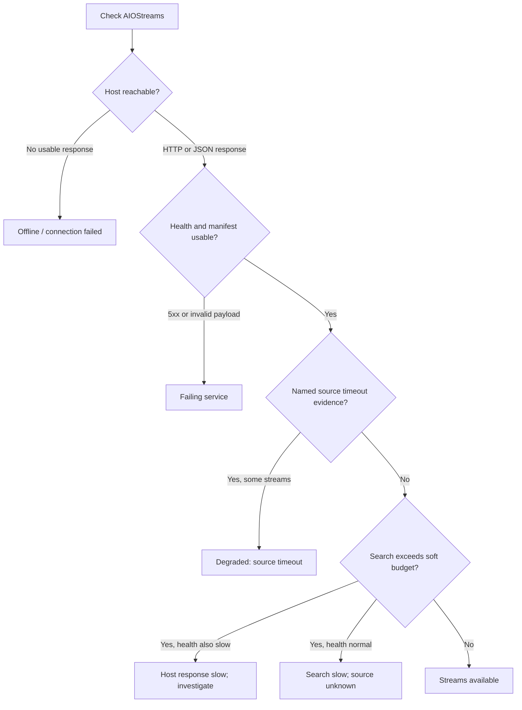

# AIOStreams TV dashboard specification

Design contract only. Build on existing AIO dashboard and Sources inspectors; no new screen framework. Research, sources, measurements and implementation jobs: [PESQUISA.md](PESQUISA.md).

## Purpose and information order

From the couch, answer three questions: can I watch; what is delaying me; what can I do now? Default overview gives one verdict, one supporting measurement and at most three next actions. Provider details and configuration rules are one OK press away. Do not make a viewer read HTTP tables or understand authentication to start a title.

The current owner observation should render **“Streams available”**, supporting **“Series search: 4.3 s median · 5 checks”**, secondary **“Source timing unavailable”**. Configuration gets a separate **“Phone sign-in needed”** state. Do not render “All add-ons healthy,” “host slow,” “Comet timing out” or “too many catalogs” as established faults from this sample.

## Shared visual and remote contract

Follow the external Nuvio DESIGN.md and 2.0.8 shared components. Reference canvas 1920×1080, 24 px minimum outer island margin, existing shell/content geometry and clock island clearance. Keep ordinary content inside an approximately 1600×850 safe region; existing shell defines final placement. No independent dashboard chrome, nested cards, decorative outlines or web-style dense tables.

- `plrui_material` owns the main island and modal material; use same radius, corner light, short shadow and glass/solid fallback as clock island. Main sheet radius 28; rows 20–22; modal 30–36. Keep glass and solid geometry identical. Glass veil 30%, solid 42%; never simulate gradients with stacked flat fills.
- `plrui_linha_foco` owns list/card focus: one brighter neutral surface, no border and no full-accent row. Row action button/chip focus uses existing full accent pill with contrast text. Accent from `ajustes_acento()` and tint helpers only; status uses semantic theme helpers plus text/icon, never color alone.
- `plrui_seg` supplies four sections: **Overview**, **Add-ons**, **Configuration**, **Fixes**. Existing sidebar may carry the same destinations; do not keep two independent navigation models. Selected section and current focused control remain distinguishable.
- `plrui_dicas` supplies footer **OK Details / Back Return** or screen-specific equivalents. Never display a shortcut without a working action. Normal arrows and OK suffice; no long-press, color-key or pointer dependency.
- Clock island remains the global activity owner. During a check show `activity` icon and “Checking AIOStreams”; after navigation away, continue/cancel according to existing request owner. Do not create another floating progress toaster. Announce a result once; no recurring error pop-ups during browsing/playback.
- Inter Display / existing `TXT_*`: title 40/700, verdict 32–36/700, row title 24–28/Bold, normal supporting text at least 19, prominent values 28. At most two lines per row, five visible data rows. 15–16 px only for nonessential timestamp/footer, never verdict/fix. Measure long translations at 85% and 100% text scale; wrap supporting copy instead of shrinking essential text.
- Lucide icons only, through existing `aj_` asset mapping: `layout-dashboard`, `activity`, `server`, `puzzle`, `timer`, `circle-check`, `triangle-alert`, `circle-x`, `wifi-off`, `list-filter`, `sliders-horizontal`, `shield-check`, `lock-keyhole`, `refresh-cw`, `smartphone`, `chevron-right`, `arrow-left`, `clock-3`, `circle-help`. All use consistent stroke/size. Do not render remote emoji, ASCII art, decorative medals or remote provider logos as status.
- Every visible string, plural, unit, duration, state and accessibility label uses i18n; new keys in byte order in `idioma_tab.h`, synchronized/translatable in all supported languages. Example English copy here is a semantic requirement, not a hardcoded literal. Source brand names are sanitized data, not translation keys. Numeric placeholders remain format-safe.

Focus rules: Left/Right changes section only while section selector owns focus; Down enters its first saved content row; Up from first row returns to selector. Lists use Up/Down, page through existing scrolling helpers and retain logical focused identity when data updates. OK opens detail; Back returns to prior section, row and scroll, then exits to the originating Add-ons/Sources entry. No focus wrapping between unrelated sections. Loading/refresh never steals focus or moves a selected stream. Empty lists focus their first enabled action. Refresh is disabled while a same-scope check is in flight or until a rate-limit deadline; Back always works. On profile/account change, discard old results and focus state that references them.

## Evidence and verdict model

Keep transport, source search, config authorization and inventory distinct. Each fact has origin (this TV / upstream statistic), sample count, timestamp, content type and unavailable reason. Configured provider, provider seen in results and provider timed by server are different facts. A result list capped at 20 cannot enumerate every enabled source.

Initial product thresholds are proposed defaults, not upstream guarantees: slow host response when at least two of the last three nearby health/manifest control samples have TTFB above 2 s; slow search when completed total exceeds 5 s, or a pending search crosses 5 s. Do not count three endpoints from one slow search as three independent controls. Display the actual number and “may be” language for attribution. Search at 5 s is still working; use existing hard VOD network deadline, initially 30 s, with cancellation and a user retry after completion. One failed control gives “Connection problem” until retried, not a confident claim the server is down.

Specific verdict rules:

| Copy | Evidence required | Action |
|---|---|---|
| Streams available | Valid playable candidates; no known current fatal error | Return to Sources / inspect latest check |
| Search is slow | Search >5 s; host control not slow or unknown | Source timing / phone configure guide |
| Host response is slow | Multiple slow controls as above; show measured RTT/TTFB | Check connection / host dashboard guide |
| Add-on {name} timed out | Structured upstream error or recognized Search error explicitly names source and timeout | Detail with evidence time, then phone configure |
| Some add-ons failed | Named current errors plus playable candidates | Keep available streams; review providers |
| No streams for this title | Valid empty results, no proven source outage | Try another title / inspect filters |
| AIOStreams returned an error | Invalid configuration or valid server error with no playable results | Phone configure / retry appropriate to error |
| Cannot reach AIOStreams | DNS/TLS/connect failure or expired deadline, distinguished in details | Retry / connection guide |
| Configuration access unavailable | User endpoint 401/403; manifest/search may still work | Phone sign-in; no disconnect/reinstall requirement |
| Source timing unavailable | Statistics absent/disabled/unknown format | Explain how to enable statistics on phone |
| Many catalogs: {count} | Large inventory only | Review catalogs; informational, not a failure |
| Too many catalogs loaded | Local row cap hit, measured Home load/memory budget exceeded, or explicit truncation | Reduce loaded rows / review catalog selection |
| Wait before checking again | HTTP 429 or retry deadline | Countdown; one later explicit check |

Thresholds use small fixed sample history in existing scoped stats, not continuous polling. For a single manual check, default to measured facts and unknown attribution. Never subtract health RTT from search time and label the remainder exact “add-on time.” Public health only checks the DB path. Unknown response type/invalid JSON is failing data, not a successful empty result. Raw upstream text is untrusted: classify into local i18n copy, allowlist safe provider name and parsed duration, hide the rest.

## Screen 1: Overview

Entry: existing Add-ons › AIOStreams or Sources › AIO information. Header: `layout-dashboard`, “AIOStreams”, sanitized version/channel, “Checked {relative time}”. Right header has one labeled “Check now” chip with `refresh-cw`.

Body, top to bottom:

1. One verdict line with semantic Lucide icon, e.g. `triangle-alert` “Search is slow”. Under it, “Streams still available” or “No streams received”. Show one concrete measurement: “Latest series search 5.9 s · Host check 0.5 s”. Do not show a decorative health score.
2. Three flat rows: **Host**, **Add-ons**, **Configuration**. Each has status in words and one value. Example: “Host responds · 0.5 s”; “Source timings unavailable · 20 streams returned”; “Phone sign-in needed”. Entire row opens relevant detail, with `chevron-right`.
3. Optional contextual catalog row: “248 catalogs advertised · Review selection”. It is not red or a diagnosis. Config unavailable does not hide the manifest count.
4. Primary action matches verdict: healthy “Back to Sources”; degraded “Review fixes”; failing/offline “Try again” after backoff. Secondary “Configure on phone”. Keep two actions visible; version/raw HTTP details belong in details.

State behavior:

| State | Content and action |
|---|---|
| Loading | Stable shell and cached facts with “Previous check”; indeterminate clock activity; show “Checking host” / “Searching for streams”; Back available |
| Healthy | Streams available; measured latest check and sample count; no implication every configured source was tested |
| Degraded | Available streams remain actionable; lead with confirmed named issue or honest search-slow verdict; never gate watching behind fix |
| Failing | Server responded but no usable result due to HTTP/payload/config error; show local explanation and targeted fix |
| Offline | “Cannot reach AIOStreams”; cached version/config visibly old; retry and connection guide; do not overwrite last success with zero |

Config restriction is a secondary capability state, not a reason to set the whole overview failing. A 401-only optional API gives a lock icon on Configuration. A 429 shows countdown on Check now and preserves prior data. A valid empty search offers another-title/filter guidance; it does not impersonate offline.

## Screen 2: Add-on health and latency

Header `puzzle`, “Add-ons”, subtitle “Latest {movie/episode/anime} check”. Segment/filter inside the existing content slot: **Needs attention / All observed**; counts mean observed entries, not all installed providers. When config access exists, add separately labeled **Configured** inventory; never silently merge an enabled list with measured health.

At most five flat rows per page. Each row: provider name left, verdict on second line; right column elapsed time and result count only when measured. Example synthetic row: “Comet / Timed out / 5.0 s limit”; healthy synthetic row: “Torrentio / Responded / 1.2 s · 12 results”. Timing source label “Reported by AIOStreams” appears in shared subtitle. Use “Not reported” rather than 0 ms. Unknown/custom provider labels are hidden unless they pass explicit safe-label rules.

Default stable order: current errors, slow measured providers, other measured providers, unknowns. Freeze order while focused; apply reordering on explicit refresh/return so focus identity survives. No live animated ranking or health percentages from one sample.

OK opens an add-on detail island with provider + local verdict, checked title type/time, reported duration/timeout budget if known, number returned, and one explanation/action. Examples: “This source exceeded its configured timeout. Other sources returned streams.” Actions “Configure on phone” and “Back”. If only Search error text is available, label “Reported timeout; duration not supplied”. No fabricated timer counting against an unknown provider budget.

| State | List / detail behavior |
|---|---|
| Loading | Cached rows remain, tagged previous; first visit shows “Waiting for source diagnostics”; footer Back |
| Healthy | Measured sources responded; explain only observed sources assessed; no disabled provider counted as failed |
| Degraded | Named failures shown first; keep successes and available stream count visible |
| Failing | All observed sources errored or search invalid; distinguish no source metrics from all-source failure |
| Offline | Cached observations marked old; cannot update; retry in overview |

For the owner today: list returned contributors as **Seen in results** with no timings, plus “Timing statistics were not provided.” A “How to enable timings” action opens Fixes. No enabled count or green source-health verdict can be derived from result contribution. Error/statistic informational streams never appear in Sources' playable count or Links' phone targets.

## Screen 3: Configuration summary

Header `sliders-horizontal`, “Configuration”. Six flat groups, with at most five visible and existing scroll behavior:

- Sources and services: enabled/disabled counts when authenticated inventory exists; otherwise “Not available from installation link”. Show known service names, never credentials.
- Catalogs: full advertised total, locally visible count only if independently known; OK opens catalog subpage with paged remote order and local show/hide. Clearly label “On this TV” vs “In AIOStreams”. Remote modification remains phone-only.
- Filters and ranking: summary of required/excluded/preferred rules, cache policy and limits; opens existing detailed inspector. Keep required/excluded precedence explicit.
- Formatter: name/passthrough mode if known; raw templates hidden because they can contain signed links.
- Proxy and playback: enabled/type/proxied service count when known; no host/token or untested “working” badge. Explain it may be needed for playback.
- Diagnostics and variants: statistics capability, Search availability, effective variant/inheritance uncertainty and config access state. Hide arbitrary scripts/expressions; use safe existing detail traversal only.

Footer “Configure on phone” and “Refresh summary”. Phone handoff uses existing private pairing; show a neutral session/pairing control on TV. Do not encode `<owner-manifest>` or `<owner-manager>` in a visible QR captured by screenshot tests. Official generic configure origin may be used through the existing safe flow; credential-bearing destinations stay in protected storage and private delivery.

| State | Content and action |
|---|---|
| Loading | Cached config clearly previous; no zero-filled source/filter totals |
| Healthy | Resolved known summary; timestamp and capability provenance; remote/local scope labels |
| Degraded | Streams work but config locked/partial schema/truncated; show exact available subset and explicit omitted count |
| Failing | Authenticated summary invalid or unavailable; no overwrite of useful cached summary; targeted phone guide |
| Offline | Read-only cached summary marked old; offline “not changed” state; no implied remote save |

Config access 401/403 opens a dedicated lock state within this screen: “This installation link can play streams. Configuration details require sign-in on your phone.” Primary phone guide; secondary Back. No raw password keyboard, no uninstall recommendation. Search still usable independently. Catalog subpage counts all 248 even when only a bounded page is stored; last entry must be reachable. If a local budget excludes rows, explain the exclusion and scope without claiming remote disablement.

## Screen 4: Fixes

Header `list-filter`, “Recommended fixes”. Maximum three recommendations at once, ranked by supported evidence. Each row has one plain title, one consequence, and an action. No automatic remote configuration changes.

| Trigger | Recommendation | What OK does |
|---|---|---|
| Named provider timeout | “Review {name}'s timeout or fallback group” | Detail explains reliability/coverage tradeoff, then phone configure |
| Search slow, no source metrics | “Enable source timing statistics” | Phone instructions: Statistics enabled, Add-on and Timing; save there, then Check again |
| Host controls slow | “Check your host connection and capacity” | Explain TV network vs host/DB possibilities; explicit Check again; no unsupported reboot button |
| Large inventory only | “Load fewer catalog rows” | Local Home row controls; remote catalog guide separately labeled |
| Config 401 | “Open configuration on your phone” | Existing sign-in/handoff flow; no attempt to decrypt credentials |
| 429 | “Wait before checking again” | Countdown; retry disabled until deadline |
| No results, no errors | “Review filters or try another title” | Existing filter inspector when available, else phone guide/title picker |
| Proxy observed, playback untested | “Check proxy only if playback fails” | Explain required-header/IP use; no recommendation to disable from search latency alone |

Recommendation detail contains evidence, one short explanation and at most two steps, e.g. “1. Open Statistics on your phone. 2. Enable Add-on and Timing, save, then check again.” Footer primary “Open on phone”, secondary “Back”. “Check again” appears after returning, runs one scoped check and preserves prior screen focus. Never say fixed just because a phone page was opened.

| State | Recommendations |
|---|---|
| Loading | Previous findings retained; “Checking for current issues” |
| Healthy | “No action needed for the latest check”; optional catalog review stays neutral |
| Degraded | Evidence-ranked fixes; available-stream action remains visible |
| Failing | One most relevant recovery step; avoid unrelated cache/catalog advice |
| Offline | Connection guide and one retry; configuration controls unavailable |

## Acceptance and scope limits

Future implementation must show every five-state screen with synthetic data, both glass/solid and 85/100% scale. Remote sequence: enter overview from Add-ons, switch Add-ons section, scroll to sixth item, open detail, Back restores item/scroll, open Fixes, return, refresh, retain focus, Back exits to original entry. Repeat from Sources with live updates; no selected stream displacement. Test long names/translations, unknown metrics, zero results, optional config 401, rate countdown, profile switch, stale cache and late worker response.

Accessibility: essential text contrast at least 4.5:1, large text 3:1, focused control visually distinct without color alone; reduce decorative motion with existing setting. Verify full text at couch distance on target TVs. Metadata/provider text must be sanitized before layout and never rendered as markup. Unknown timestamps/metrics are labeled unavailable. Screenshot fixtures use synthetic source names/targets only; no private URL, credential or encoded config appears in screenshots or logs.

No rendered mockup or device screenshot is claimed in this research pass. Native layout, performance, screen-reader/platform accessibility and first-frame playback remain implementation/device acceptance tasks. Existing approved island/component appearance is the visual reference; this document specifies hierarchy, navigation and truthful states.
